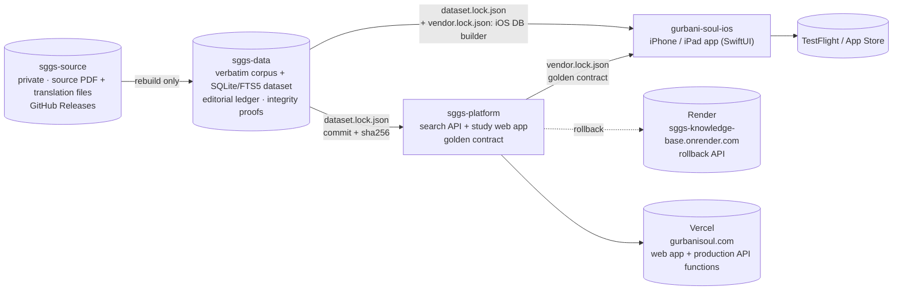
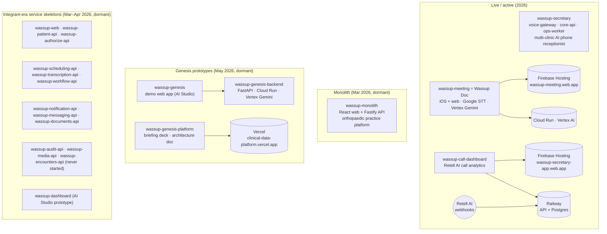
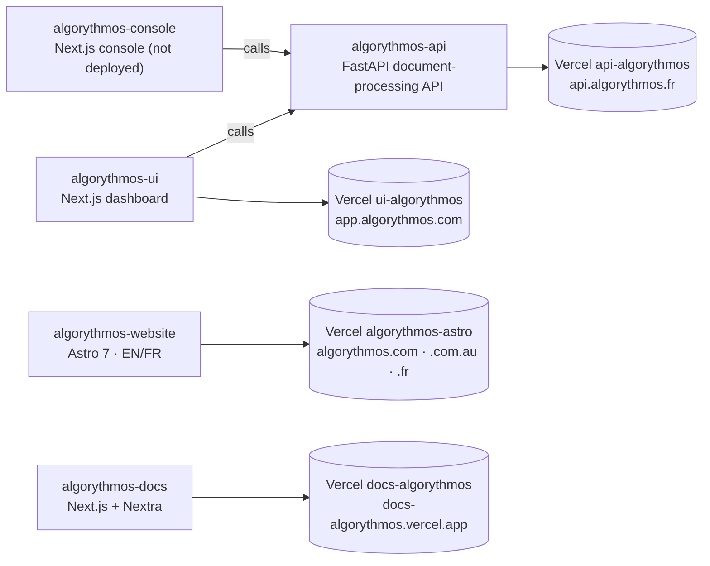
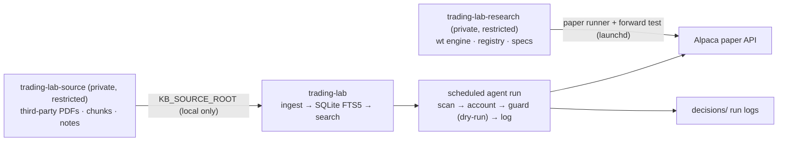
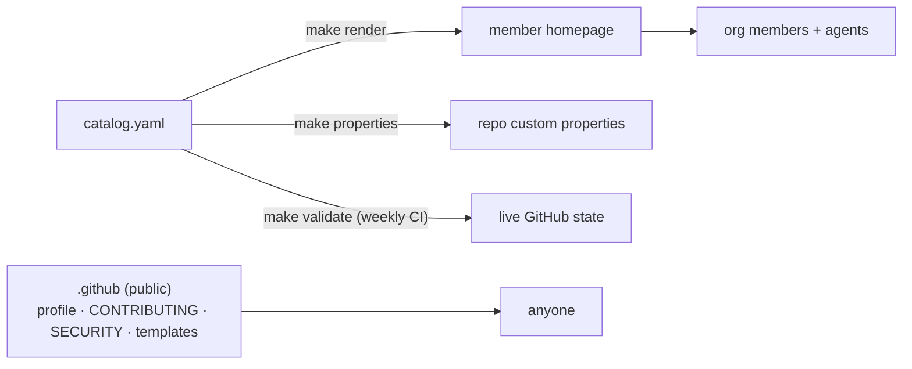

# Architecture — how the repos fit together

One diagram per product. Boxes are repos; cylinders are where things run. Facts come from each
repo's workflows, `vercel.json`/`render.yaml` and lock files (re-read those files rather than
trusting memory). Live URLs are the ones that answered 200 on 25 Sep 2026.

## Gurbani Soul



- **Trust chain:** `sggs-data` publishes one database per commit; consumers refuse a database whose
  sha256 doesn't match their pin. The iOS app's search core must match the API byte for byte
  (`make parity`). Scripture text changes only through the editorial ledger.
- **Branches:** `sggs-platform` uses `integration` → `main`; `sggs-data` and `gurbani-soul-ios` use
  `main` with release tags.
- **Cross-repo reads in CI** use `secrets.SGGS_READ_TOKEN || github.token`, so the data repos can go
  private later without code changes ([`go-private.md`](go-private.md)).

## WASSUP



- There is **no dependency** between the four generations; each was a fresh start. Only the top group
  is deployed. The generation table with dates and commit counts is in
  [`wassup-product-map.md`](wassup-product-map.md).
- Naming trap: the call dashboard is hosted at `wassup-secretary-app.web.app` for historical reasons.
  It is not the Secretary product.
- `wassup-secretary` deploys by script, not by workflow: `integration` goes to Railway staging by exact commit
  (`scripts/deploy-railway.sh`); production runs only `v*` tags on `main` (its `docs/runbooks/release.md`).

## Algorythmos company platform



- Working hosts (checked 25 Sep 2026): `api.algorythmos.fr` (DNS added 25 Sep) and `app.algorythmos.com`.
  `app.` and `docs.algorythmos.fr`, and `api.`/`docs.algorythmos.com`, have **no DNS records**; use
  `docs-algorythmos.vercel.app` for the docs. Every project also answers on its `*.vercel.app` URL.
- `algorythmos-api` uses Neon Postgres and runs migrations on production deploys (its PR #19).
  See its catalog note for open items.

## Trading Lab

Paper-trading research: a knowledge base over trading literature plus a guarded gap-and-go
pipeline against an Alpaca **paper** account. Runs locally; nothing is deployed. Order submission
is frozen until its risk-control milestone lands (trading-lab ADR-0001).
The research engine (`trading-lab-research`) holds the `wt` package, the strategy registry
(hypotheses, experiments, decisions) and a paper runner scheduled by launchd. It tests
course-derived rules, so it is restricted and never public.



| Repo | Holds | Visibility |
|---|---|---|
| `trading-lab` | Code, prompts, run logs, `docs/` wiki and ADRs, backlog source | Public for now, intended private |
| `trading-lab-source` | The licence-restricted source publications and text extracted from them | Private, never public |
| `trading-lab-research` | Research engine (`wt`), strategy registry, specifications, paper runner | Private, never public |

## Client websites

| Repo | Client | Live | Stack | Vercel project |
|---|---|---|---|---|
| `ichr-website` (public) | International Coalition for Human Rights | www.ichr-international.org | Astro + Prisma/Neon, `integration` → `main` | `ichr` |
| `pdto-website` | PDTO | www.pdto.org | Vite + React | `pdto-org` |
| `src-website` | Sudanese Rural Community (SRC) | www.src-rural.org | Next.js + Payload CMS/Neon, `integration` → `main` | `src` |
| `australians-care-website` | Australians Care | www.australianscare.com.au | Vite + React | `australians-care` |
| `pure-sydney-cleaning-website` | Pure Sydney Cleaning | www.puresydneycleaning.com.au | React | `pure-sydney-cleaning` |
| `elizabeth-cleaners-website` | Elizabeth Cleaners | www.cleaningelizabeth.com.au | Vite + React | `elizabeth-cleaners` |
| `mazcina-website` | Mazcina | mazcina.vercel.app | Astro | `mazcina` |
| `renovations-australia-website` | Renovations Australia | renovations-australia.vercel.app (renovationsaustralia.com.au has no DNS) | Astro | `renovations-australia` |
| `cabinets-and-wardrobes-website` | Cabinets & Wardrobes | cabinetsandwardrobes.vercel.app | Astro | `cabinetsandwardrobes` |
| `regenu-website` | RegenU | regenu-website.vercel.app | static HTML | `regenu-website` |
| `margaret-property-services-website` | Margaret Property Services | margaret-property-services.vercel.app | Vite + React | `margaret-property-services` |
| `marigold-website` | Marigold International Society | marigold-international-society.vercel.app | Vite + React | `marigold-international-society` |
| `integrant-portal` | Integrant Pty Ltd | not deployed from this org | Next.js | — |

Every site auto-deploys production from its default branch. Docs-only commits (`README.md`,
`LICENSE`, `.github/CODEOWNERS`, `.github/dependabot.yml`) are skipped by each project's Ignored
Build Step (decision D-018):

```sh
if [ -n "$VERCEL_GIT_PREVIOUS_SHA" ] && git diff --quiet "$VERCEL_GIT_PREVIOUS_SHA" HEAD -- . ":(exclude)README.md" ":(exclude)LICENSE" ":(exclude).github/CODEOWNERS" ":(exclude).github/dependabot.yml" 2>/dev/null; then exit 0; else exit 1; fi
```

It must only ever exit 0 (skip) or 1 (build); Vercel fails the deployment on any other code. Anything
uncertain (first deploy, previous commit missing from the shallow clone, `.git` stripped by
`.vercelignore`) builds. A `vercel.json` `ignoreCommand` in a repo overrides the dashboard setting;
`algorythmos-api` has its own (`scripts/vercel_ignore.sh`).

## Vision On Care (archived)

A March 2026 prototype, imported and archived on 25 Sep 2026 (decision D-013). Nothing here is
developed; read it for history only.

- `visiononcare-web` — the only substantial code: React + Vite front end with mock-backed workflows
  (participants, workers, shifts, notes, funding, invoices). Vercel project `vison-on-care-frontend`
  (spelling as created) still serves the last build at vison-on-care-frontend.vercel.app.
- `visiononcare-api-gateway` and 12 `visiononcare-*-service` repos — identical FastAPI scaffolds
  (about 1 KB of code each, two commits); never implemented.
- `visiononcare-worker-mobile` — created empty; never started.

## Org plumbing


